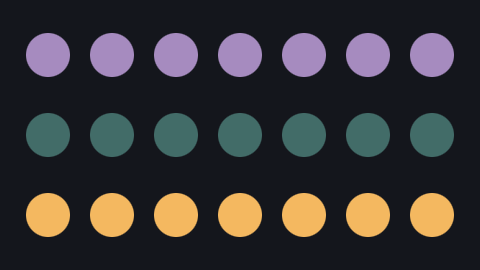

# Invalid color strings

Fixes #581, related to #569 and #570.

## Behavior

`Color::from_hex` returns `RenderError::InvalidColor` for non-ASCII inputs
instead of slicing through a UTF-8 character and panicking. The parser checks
ASCII before its fixed two-byte channel slices. Existing ASCII parsing and
error handling remain in place.

React's `<Instances fill>` accepts a string and forwards it as the scene's
shared particle color. Both native renderers parse that color through this
function, so a malformed value can reach it during ordinary composition
rendering. The regression tests cover the parser, CPU Instances rendering,
and a live React bridge entry rendered by the CPU reference renderer.

The English and Japanese guides and the Celesta Agent Skill document the
hex format and the invalid-color error for non-ASCII particle fills.

## Rendering comparison

The same 480×270 CPU scene was rendered before and after the parser change:
three rows of seven circle instances using `#a68bbf`, `#70c1b380`, and
`#f4b860`. The output PNGs are byte-for-byte identical (`cmp`). The middle
row exercises the alpha channel. An invalid input has no before image because
it panics before producing a frame.

| Before | After |
| --- | --- |
|  |  |

## Validation

- Before the fix, both new `without_panicking` regression tests failed with
  `end byte index 2 is not a char boundary` in `Color::from_hex`.
- `cargo test -p celesta-renderer --offline`: 227 unit tests and one project
  pipeline integration test passed.
- `pnpm run build:runtime`: passed, including composition/project codegen tests.
- `cargo clippy -p celesta-renderer --all-targets --offline -- -D warnings`:
  passed.
- The compiled `node_integration` test binary, run with
  `CELESTA_NODE=/opt/homebrew/bin/node` and the `invalid_instance_fill` filter,
  passed through the live React → bridge → CPU path without skipping.
- `cargo fmt --all -- --check` and `git diff --check`: passed.
- `cargo clippy --workspace --all-targets --offline -- -D warnings` reached an
  existing `clippy::large_enum_variant` error in
  `crates/editor/src/layer_select.rs:16` (`SourceLookup`). That file is
  unchanged from `origin/main`.
- The sandboxed workspace test run could not find a Metal adapter and failed
  GPU-dependent exporter tests. `cargo test --workspace --offline` passed when
  rerun with native GPU access, including the live bridge regression and the
  GPU renderer tests.

The installed mise shims could not run within the sandbox, so Cargo commands
used the installed Rust 1.99.1 toolchain directory on `PATH`.
