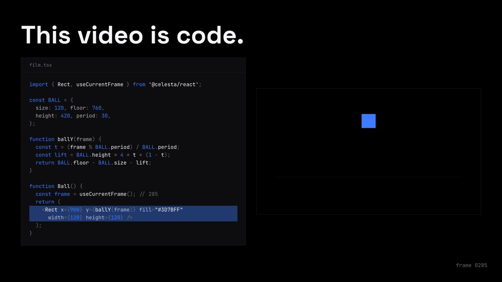

# INTRO — This video is code.

Celesta を初めて知る開発者向けの、YouTube 用 60 秒の紹介動画（1920 × 1080 / 30 fps）。
完成したモーショングラフィックとして始まり、途中で「いま映っている絵を描いているコード」が隣に現れます。
動画そのものが、紹介している「動画をコードで書く」やり方で作られていることを見せる構成です。
配色と書体はサイトの Noir テーマ（黒・白・アクセントの青 1 色、Space Grotesk と JetBrains Mono）に合わせ、
120 BPM のオリジナルスコアに合わせて小節の頭でカットします。

- `film.tsx` — Celesta の File → Open… で開く React ソース（エントリ）。シーンは `scenes/`、共通部品は `components/` にあります。
- `shared/` — 画面に描くと同時に、コードとしても表示する値（ボールの式、カードのデータ、ライブ編集の台本、書き出しの進捗、シーンの開始フレーム）。Celesta の API を使わない素の TypeScript です。
- `test/` — `shared/` のテスト。画面に表示したコードを実際に実行し、描画に使った値と一致することを確かめます。
- `make-score.py` — BGM を生成する Python スクリプト。標準ライブラリのみ。
- `poster.jpg` — Reveal の 1 フレーム（コードとプレビューが並ぶ構図）を 1280 × 720 にしたもの。YouTube のサムネイル用。



## 構成

120 BPM（1 拍 = 15 フレーム、1 小節 = 60 フレーム）。右下には全編を通して `frame 0000` の形で現在のフレーム番号が出ます（終了画面の静止中は消えます）。

| 時間 | シーン | 内容 |
| --- | --- | --- |
| 0–6 秒 | Cold open | 青い正方形が拍に合わせて弾み、`Titles.` `Charts.` `Captions.` の短いモーションが 1 拍ずつ 2 巡する |
| 6–10 秒 | Reveal | 映像が右半分のプレビューに縮み、左にそれを描いている `film.tsx` が打ち込まれる。`<Rect>` の行がボールの高さに合わせて光り、コメントに現在のフレーム番号が出る。「This video is code.」 |
| 10–18 秒 | Problem | タイムライン編集画面でキーフレームを 1 つずつ手で動かし、1 回のずれで後ろが全部崩れる。最後にすべてが `y = spring(frame)` の 1 行に吸い込まれる |
| 18–26 秒 | Idea | `frame → picture`。スクラブバーを前後に動かすと、ボールは同じフレーム番号では必ず前回の輪郭の上に戻る。「A frame is a function of time.」 |
| 26–34 秒 | Components | `Card` コンポーネントと 12 都市の配列から 12 枚のカード。配列の値が変わると、その行が光り、対応するカードの数字とバーが同じフレームで変わる |
| 34–44 秒 | Live edit | エディタで `fontSize` を 96 → 160、色を白 → 青に書き換える。⌘S を押したフレームでだけプレビューが更新される |
| 44–52 秒 | Export | `celesta-exporter --react film.tsx intro.mp4` で、この動画自身の 1800 フレームがモザイクとして埋まる。続いてエージェントのログ |
| 52–60 秒 | Outro | CELESTA のロゴ、キャッチコピー、リポジトリ。55 秒（1650 フレーム）からは何も動かず、右半分は YouTube の終了画面の要素を置くために空けてあります |

## 本物と演出

- **本物**: 画面に出るコードは、そのシーンを実際に描いているコードを簡略化したものです。
  Reveal と Idea のボールの式（`shared/ball.ts` の `BALL_SOURCE`）、Components の配列、
  Live edit のコードと保存のタイミングは、表示している文字列を `test/` で実行し、描画に使った値と照合しています。
  Export のモザイクの各タイルは、この動画の 6 フレームごとのボールの高さから色を決めています。
- **演出**: タイムライン編集画面、ターミナル、エージェントのログ、エディタとプレビューの画面は説明のための描画で、
  アプリやツールの画面収録ではありません。書き出しの進捗は実際の処理時間ではありません。
  ログの文言は実際の作業（Skill を読み、コンタクトシートで確認し、書き出す）に沿っています。

## 再生成

WAV と MP4 はリポジトリ全体の設定で Git の管理対象外です。クローン後は最初にスコアを生成してください。

```sh
python3 examples/intro/make-score.py
node --test examples/intro/test/
node skills/celesta/scripts/inspect.mjs examples/intro/film.tsx --every 15
celesta-exporter --react examples/intro/film.tsx intro.mp4
```

ソースから実行する場合は `celesta-exporter` を
`cargo run -p celesta-exporter --release --` に置き換えます。
フォントは初回に Google Fonts から取得され、以降はキャッシュされます。

## 素材

フォント：Space Grotesk、JetBrains Mono（いずれも SIL Open Font License、Google Fonts から配信）。
映像とスコアはこのリポジトリのためのオリジナルの手続き的制作です。
