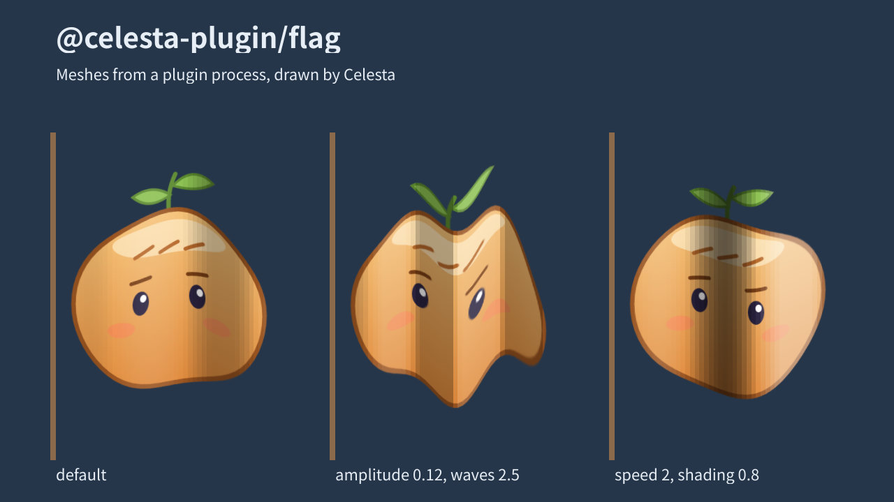

# flag

A sample content plugin with a program: `<Flag src>` draws an image waving
like a flag on a pole at its left edge.



```tsx
import { Flag } from '@celesta-plugin/flag';

<Flag src="./portrait.png" x={80} y={160} amplitude={0.1} waves={2} speed={1} shading={0.3} />
```

| Prop | Meaning |
| --- | --- |
| `src` | A PNG or JPEG. |
| `amplitude` | How far the free edge swings, as a fraction of the image's height, up to 0.15. Default 0.06. |
| `waves` | Wavelengths across the image. Default 1.5. |
| `speed` | Waves passing a point each second. Default 0.8. |
| `shading` | How much the folds darken and lighten the cloth, 0 to 1. Default 0.3. |

The layer is the image's width, and its height plus 15% above and below for
the wave. The common props (`x`, `y`, `scale`, `opacity`, …) work as on any
layer.

In the desktop app, **Add > Flag** asks for an image and draws the flag
where you drag, as **Add > Image** does: its manifest lists the component
(`components` in [`plugin.json`](plugin.json)).

## How it works

- [`js/index.ts`](js/index.ts) is the module entries import. `<Flag>` renders
  a host element, and the function registered for it turns its props into
  plugin content: plugin `flag`, the image as asset `image`, the sequence's
  time, and the wave settings as `data`.
- [`src/lib.rs`](src/lib.rs) is the plugin's `ContentProvider`. `open` reads
  the image's size and answers with the model: the canvas, the image as its
  one texture, and 48 vertical strips of triangles. `frame` answers with each
  strip's vertex positions for a time, and a multiply and a screen color that
  shade it by the wave's slope. The positions depend only on the time and
  `data`, as Celesta requires.
- [`src/main.rs`](src/main.rs) serves that provider over standard input and
  output with `celesta_plugin::serve`.
- [`tests/process.rs`](tests/process.rs) runs it end to end: Celesta's plugin
  host starts the built program from a plugin directory, its answers match
  the provider's, and the GPU renderer draws them.

Run `node ../build.mjs flag` to make its plugin directory, then
`demo.tsx` exports as the parent README shows.
